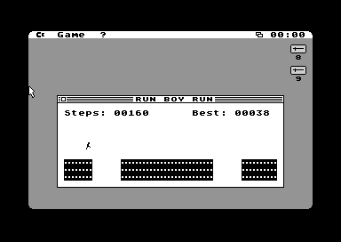
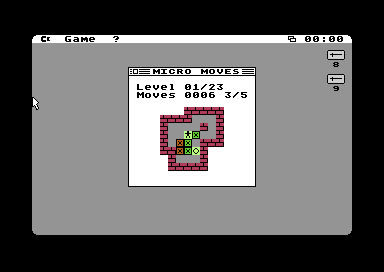
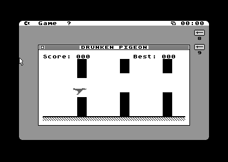
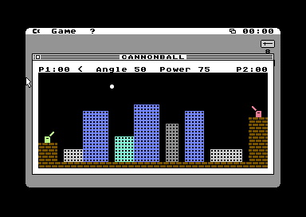
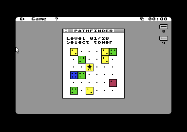
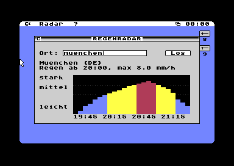
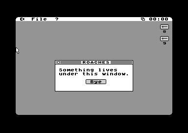

# GUI64 Apps
A coolection of AI generated apps for the [GUI64](https://github.com/WebFritzi/GUI64)

Screenshots show the GUI64 Mac version.

- [RunBoyRun](RunBoyRun/) - Canabalt clone

  

- [MicroMoves](MicroMoves/) - Sokoban clone

  

- [Drunken Pigeon](DrunkenPigeon/) - Flappy Bird clone

  

- [Cannonball](Cannonball/) - Artillery game for two players

  

- [Pathfinder](Pathfinder/) - Topple the box towers to build a path to the red box

  

- [RainRadar](RainRadar/) - Precipitation forecast for the next two hours (like Buienalarm), fetched via the Ultimate Command Interface

  

- [Roaches](Roaches/) - Fun App

  
